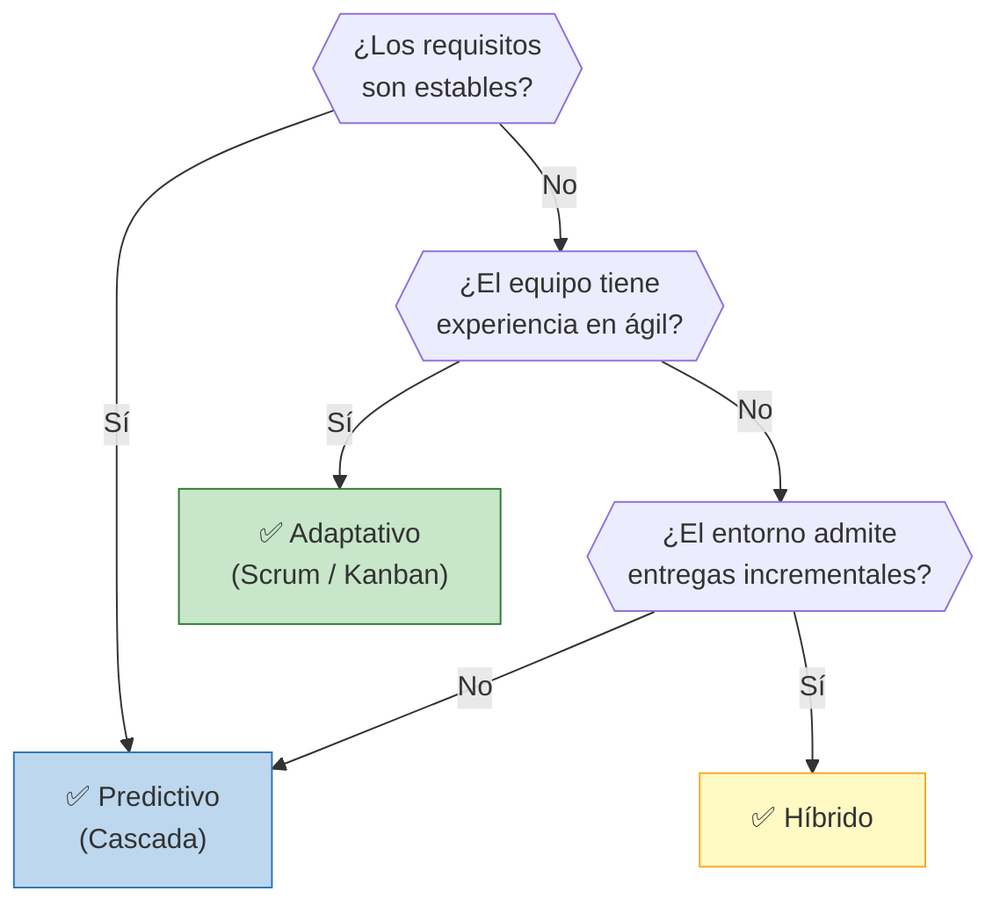
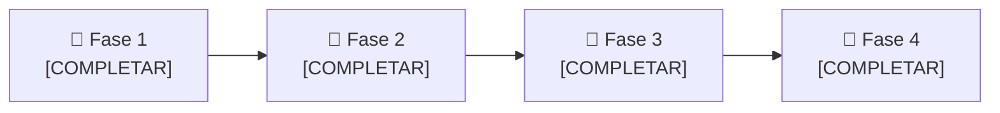

# 🔄 Ciclo de Vida del Proyecto

## Caracterización del proyecto

| Característica | Valoración | Comentario |
|----------------|:----------:|------------|
| Estabilidad de los requisitos | [Alta / Media / Baja] | [COMPLETAR] |
| Incertidumbre técnica | [COMPLETAR] | [COMPLETAR] |
| Posibilidad de entregas incrementales | [COMPLETAR] | [COMPLETAR] |
| Participación del usuario o cliente | [COMPLETAR] | [COMPLETAR] |
| Experiencia del equipo | [COMPLETAR] | [COMPLETAR] |
| Restricciones externas (hardware, regulatorias, de proveedores) | [COMPLETAR] | [COMPLETAR] |

## Alternativas consideradas

> Comparar **al menos 2** alternativas de ciclo de vida.

| Criterio | Alternativa A: [COMPLETAR] | Alternativa B: [COMPLETAR] |
|----------|----------------------------|----------------------------|
| Ventajas para este proyecto | [COMPLETAR] | [COMPLETAR] |
| Desventajas / riesgos | [COMPLETAR] | [COMPLETAR] |
| Encaje con las características del proyecto | [COMPLETAR] | [COMPLETAR] |

## Enfoque seleccionado

> **[COMPLETAR: Predictivo / Adaptativo / Híbrido / variante concreta]**

**Justificación:** [COMPLETAR: por qué es el más adecuado según la caracterización y la comparación anteriores.]

## Árbol de decisión (ayuda)

## Fases del proyecto

| Fase | Nombre | Objetivo | Criterio de salida |
|------|--------|----------|-------------------|
| 1 | [COMPLETAR] | [COMPLETAR] | [COMPLETAR] |
| 2 | [COMPLETAR] | [COMPLETAR] | [COMPLETAR] |
| 3 | [COMPLETAR] | [COMPLETAR] | [COMPLETAR] |
| 4 | [COMPLETAR] | [COMPLETAR] | [COMPLETAR] |

## Adaptación del enfoque (tailoring)

> [COMPLETAR: qué prácticas de otros enfoques se incorporan y por qué (por ejemplo, revisiones iterativas dentro de un marco predictivo).]

---

*Área de Posgrado · Gestión de Proyectos · Especializaciones FIUNER · 2026*
