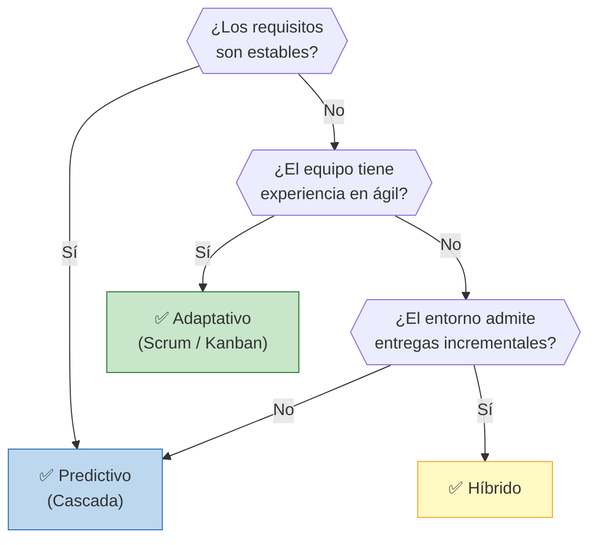
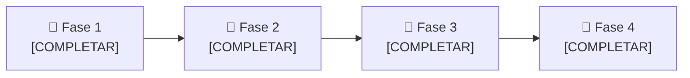

# 🔄 Ciclo de Vida del Proyecto

## Enfoque seleccionado

> **[COMPLETAR: Predictivo / Adaptativo / Híbrido]**

## Justificación de la elección

> [COMPLETAR: explicar por qué este enfoque es el más adecuado considerando estabilidad de los requisitos, complejidad, tamaño y experiencia del equipo, tolerancia al cambio, posibilidad de entregas incrementales, restricciones del entorno, etc.]

## Árbol de decisión

> **Decisión del equipo:** [COMPLETAR: indicar qué rama aplica al proyecto y por qué]

## Fases del proyecto

| Fase | Nombre | Objetivo | Criterio de salida |
|------|--------|----------|-------------------|
| 1 | [COMPLETAR] | [COMPLETAR] | [COMPLETAR] |
| 2 | [COMPLETAR] | [COMPLETAR] | [COMPLETAR] |
| 3 | [COMPLETAR] | [COMPLETAR] | [COMPLETAR] |
| 4 | [COMPLETAR] | [COMPLETAR] | [COMPLETAR] |

## Adaptación del enfoque (tailoring)

> [COMPLETAR: qué prácticas de otros enfoques se incorporan y por qué (por ejemplo, revisiones iterativas dentro de un marco predictivo).]

---

*Área de Posgrado · Gestión de Proyectos · Especializaciones FIUNER · 2026*
