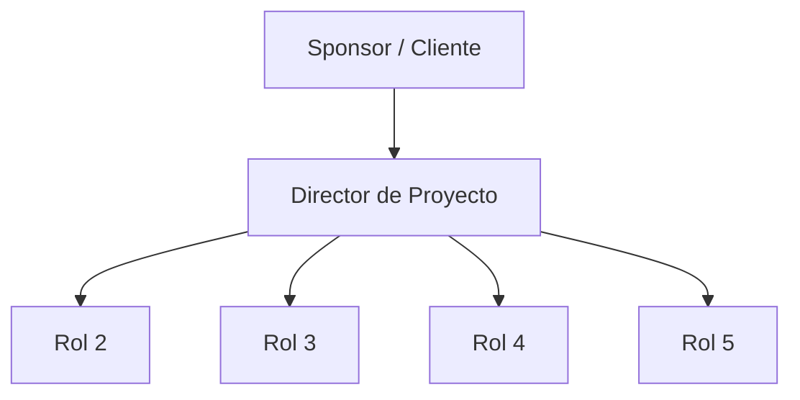

# 🏗️ Estructura Inicial del Equipo

> Propuesta inicial: se ajusta después, con la carga real de trabajo, en la Tarea 4 (RACI).

## Roles y responsabilidades

| Rol | Responsabilidades principales | Perfil requerido |
|-----|-------------------------------|------------------|
| [Rol 1 — ej: Director de Proyecto] | [COMPLETAR] | [COMPLETAR] |
| [Rol 2 — ej: Responsable de diseño] | [COMPLETAR] | [COMPLETAR] |
| [Rol 3 — ej: Responsable de desarrollo] | [COMPLETAR] | [COMPLETAR] |
| [Rol 4 — ej: Responsable de verificación] | [COMPLETAR] | [COMPLETAR] |
| [Rol 5 — ej: Responsable de calidad / documentación] | [COMPLETAR] | [COMPLETAR] |

## Asignación de personas

| Rol | Persona (integrante del equipo) | Observaciones |
|-----|---------------------------------|---------------|
| [Rol 1] | [COMPLETAR] | [COMPLETAR] |
| [Rol 2] | [COMPLETAR] | [COMPLETAR] |
| [Rol 3] | [COMPLETAR] | [COMPLETAR] |

## Usuarios y áreas involucradas

> Personas o áreas externas al equipo que participan o se ven afectadas (usuarios, otras áreas de la organización, proveedores, etc.).

| Usuario / Área | Participación en el proyecto |
|----------------|------------------------------|
| [COMPLETAR] | [COMPLETAR] |
| [COMPLETAR] | [COMPLETAR] |

## Organigrama

> Reemplazar por la estructura propuesta.

---

*Área de Posgrado · Gestión de Proyectos · Especializaciones FIUNER · 2026*
