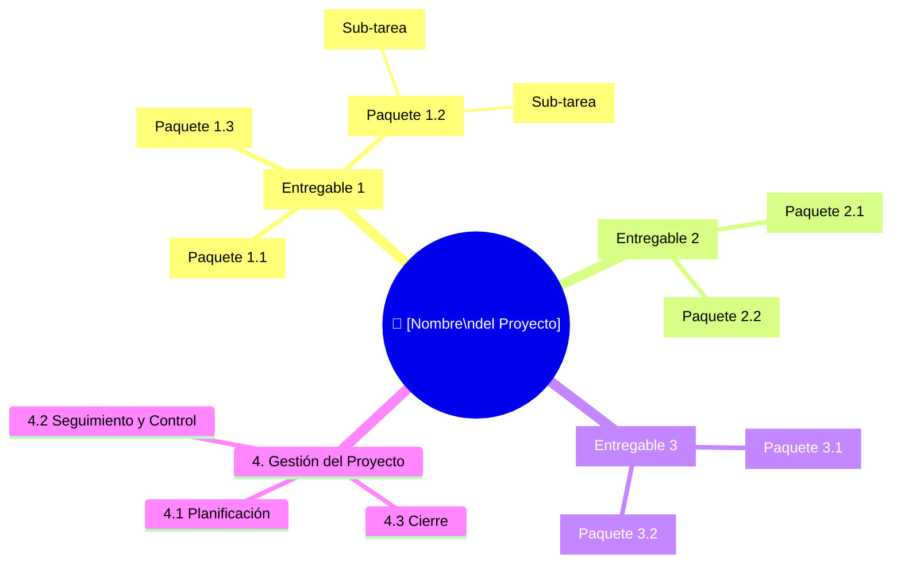

# 🌳 Estructura de Desglose del Trabajo (EDT / WBS)

> Los entregables del primer nivel provienen de [`entregables.md`](../01-ciclo-de-vida/entregables.md) (Tarea 2). La EDT cubre el 100 % del alcance y nada más.

## Diagrama de la EDT

> **Regla del 100 %:** la EDT debe incluir todo el trabajo del alcance, y solo ese.

## Diccionario de la EDT

| ID | Paquete de trabajo | Entregable asociado | Descripción | Criterio de completitud |
|----|-------------------|---------------------|-------------|------------------------|
| 1.1 | [COMPLETAR] | [COMPLETAR] | [COMPLETAR] | [COMPLETAR] |
| 1.2 | [COMPLETAR] | [COMPLETAR] | [COMPLETAR] | [COMPLETAR] |
| 1.3 | [COMPLETAR] | [COMPLETAR] | [COMPLETAR] | [COMPLETAR] |
| 2.1 | [COMPLETAR] | [COMPLETAR] | [COMPLETAR] | [COMPLETAR] |
| 2.2 | [COMPLETAR] | [COMPLETAR] | [COMPLETAR] | [COMPLETAR] |
| 3.1 | [COMPLETAR] | [COMPLETAR] | [COMPLETAR] | [COMPLETAR] |
| 3.2 | [COMPLETAR] | [COMPLETAR] | [COMPLETAR] | [COMPLETAR] |

---

*Área de Posgrado · Gestión de Proyectos · Especializaciones FIUNER · 2026*
