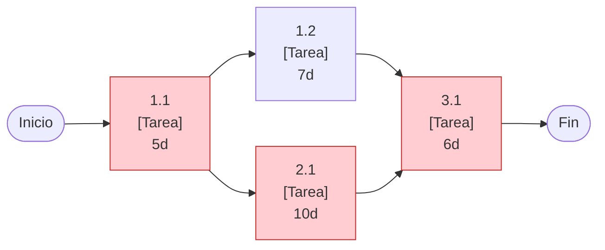

# 🕸️ Red de Tareas y Ruta Crítica

## Diagrama de dependencias

> Los nodos en rojo representan la **ruta crítica** (reemplazar según el cálculo propio).

## Tabla de precedencias

| ID | Tarea | Duración (d) | Predecesoras | Inicio temprano | Fin temprano | Holgura |
|----|-------|:------------:|--------------|:---------------:|:------------:|:-------:|
| 1.1 | [COMPLETAR] | [COMPLETAR] | — | [COMPLETAR] | [COMPLETAR] | [COMPLETAR] |
| 1.2 | [COMPLETAR] | [COMPLETAR] | 1.1 | [COMPLETAR] | [COMPLETAR] | [COMPLETAR] |
| 2.1 | [COMPLETAR] | [COMPLETAR] | 1.1 | [COMPLETAR] | [COMPLETAR] | [COMPLETAR] |
| 3.1 | [COMPLETAR] | [COMPLETAR] | 1.2, 2.1 | [COMPLETAR] | [COMPLETAR] | [COMPLETAR] |

**Ruta crítica:** [COMPLETAR: secuencia de tareas con holgura 0]
**Duración total:** [COMPLETAR] días

---

*Área de Posgrado · Gestión de Proyectos · Especializaciones FIUNER · 2026*
