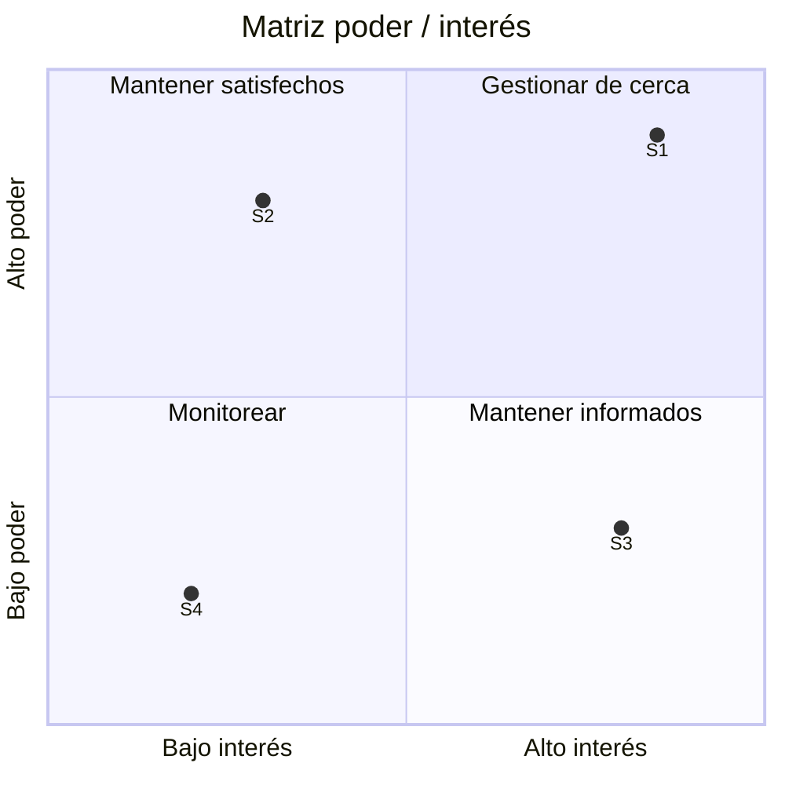

# 🎯 Matriz de Interesados (Poder / Interés)

> Reemplazar los puntos del ejemplo por los interesados del registro (valores entre 0 y 1).

## Estrategia por cuadrante

| Cuadrante | Interesados | Estrategia de involucramiento | Frecuencia |
|-----------|-------------|------------------------------|:----------:|
| Gestionar de cerca | [COMPLETAR] | [COMPLETAR] | [COMPLETAR] |
| Mantener satisfechos | [COMPLETAR] | [COMPLETAR] | [COMPLETAR] |
| Mantener informados | [COMPLETAR] | [COMPLETAR] | [COMPLETAR] |
| Monitorear | [COMPLETAR] | [COMPLETAR] | [COMPLETAR] |

---

*Área de Posgrado · Gestión de Proyectos · Especializaciones FIUNER · 2026*
