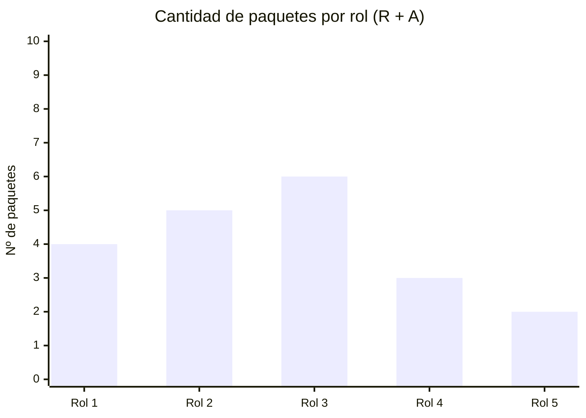

# 👥 Matriz RACI

> **R** = Responsable (ejecuta) · **A** = Aprobador (único por paquete) · **C** = Consultado · **I** = Informado
> Los roles provienen de [`organizacion.md`](../01-ciclo-de-vida/organizacion.md) y los paquetes de [`edt.md`](../02-edt-estimacion/edt.md).

## Roles del proyecto y personas

> Confirmar o ajustar la estructura propuesta en la Tarea 2. Con 5 o 6 integrantes, todos deben tener responsabilidades relevantes.

| Rol | Persona asignada | Cambio respecto de la Tarea 2 |
|-----|------------------|-------------------------------|
| [Rol 1] | [COMPLETAR] | [Sin cambios / Ajustado: motivo] |
| [Rol 2] | [COMPLETAR] | [COMPLETAR] |
| [Rol 3] | [COMPLETAR] | [COMPLETAR] |

## Matriz

| ID (EDT) | Paquete de trabajo | [Rol 1] | [Rol 2] | [Rol 3] | [Rol 4] | [Rol 5] |
|----------|--------------------|:-------:|:-------:|:-------:|:-------:|:-------:|
| 1.1 | [COMPLETAR] | A | R | I | I | I |
| 1.2 | [COMPLETAR] | A | R | C | I | I |
| 2.1 | [COMPLETAR] | A | C | R | I | I |
| 2.2 | [COMPLETAR] | A | I | R | R | C |
| 3.1 | [COMPLETAR] | A | C | R | R | I |

> ⚠️ **Verificación obligatoria:** cada fila debe tener exactamente **1 A** y al menos **1 R**.

## Análisis de carga de responsabilidades

> [COMPLETAR: analizar roles sobrecargados o con pocas responsabilidades y cómo se equilibra.]

## Asignación y dedicación

| Integrante | Rol | Dedicación (%) | Período | Total del período (%) | ¿Sobreasignado? (> 100 %) | Observaciones |
|-----------|-----|:--------------:|---------|:---------------------:|:-------------------------:|---------------|
| [COMPLETAR] | [COMPLETAR] | [COMPLETAR] | [COMPLETAR] | [COMPLETAR] | [Sí / No] | [COMPLETAR] |
| [COMPLETAR] | [COMPLETAR] | [COMPLETAR] | [COMPLETAR] | [COMPLETAR] | [Sí / No] | [COMPLETAR] |

> Sumar todas las asignaciones de cada integrante en el mismo período: si supera el 100 %, hay sobreasignación y se corrige.

## Ajustes al cronograma

| ID (EDT) | Duración original (d) | Duración ajustada (d) | Motivo del ajuste |
|----------|:---------------------:|:---------------------:|-------------------|
| [COMPLETAR] | [COMPLETAR] | [COMPLETAR] | [COMPLETAR: dedicación real, sobreasignación, etc.] |

> Si el ajuste cambia la secuencia o el camino crítico, actualizar `estimacion.md`, `red-de-tareas.md` y `cronograma.md`.

---

*Área de Posgrado · Gestión de Proyectos · Especializaciones FIUNER · 2026*
