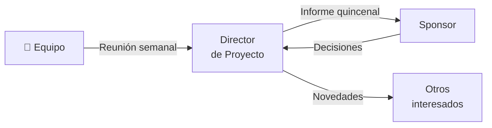

# 📣 Plan de Comunicaciones (Parte B)

> Parte de la información necesaria registrada en [`registro-interesados.md`](registro-interesados.md). Cada necesidad de información debe tener al menos una comunicación.

## Matriz de comunicaciones

| # | Información | Contenido | Formato | Nivel de detalle | Responsable | Receptores | Canal | Herramienta | Frecuencia |
|---|-------------|-----------|---------|:----------------:|-------------|------------|-------|-------------|:----------:|
| 1 | Avance del proyecto | Avance, bloqueos, próximos pasos | Reunión | Alto | [COMPLETAR] | Equipo | Interactivo | [COMPLETAR] | Semanal |
| 2 | Estado general | Avance, riesgos, cambios | Informe | Bajo | [COMPLETAR] | Sponsor | Push | [COMPLETAR] | Quincenal |
| 3 | [COMPLETAR] | [COMPLETAR] | [COMPLETAR] | [COMPLETAR] | [COMPLETAR] | [COMPLETAR] | [COMPLETAR] | [COMPLETAR] | [COMPLETAR] |
| 4 | [COMPLETAR] | [COMPLETAR] | [COMPLETAR] | [COMPLETAR] | [COMPLETAR] | [COMPLETAR] | [COMPLETAR] | [COMPLETAR] | [COMPLETAR] |

> **Nivel de detalle:** Alto, Medio o Bajo. Incluir al menos una comunicación por cada interesado del registro y todas las comunicaciones formales del proyecto.
>
> **Canal:** *Interactivo* (reuniones, llamadas), *Push* (se envía: correos, informes), *Pull* (el interesado lo consulta: repositorio, tablero, wiki).

## Flujo de comunicación

> Reemplazar los nodos y flechas por las comunicaciones de la matriz.

## Herramientas

| Herramienta | Uso | Quién tiene acceso |
|-------------|-----|--------------------|
| [COMPLETAR] | [COMPLETAR] | [COMPLETAR] |

## Escalamiento

| Nivel | Quién resuelve | Plazo máximo | Si no se resuelve |
|:-----:|----------------|:------------:|-------------------|
| 1 | [COMPLETAR: p. ej. responsable del paquete] | [COMPLETAR] | Pasa al nivel 2 |
| 2 | [COMPLETAR: p. ej. Director de Proyecto] | [COMPLETAR] | Pasa al nivel 3 |
| 3 | [COMPLETAR: p. ej. Sponsor] | [COMPLETAR] | [COMPLETAR] |

## Restricciones de la comunicación

> [COMPLETAR: confidencialidad, requisitos de registro, idioma, husos horarios, disponibilidad de los interesados.]

---

*Área de Posgrado · Gestión de Proyectos · Especializaciones FIUNER · 2026*
