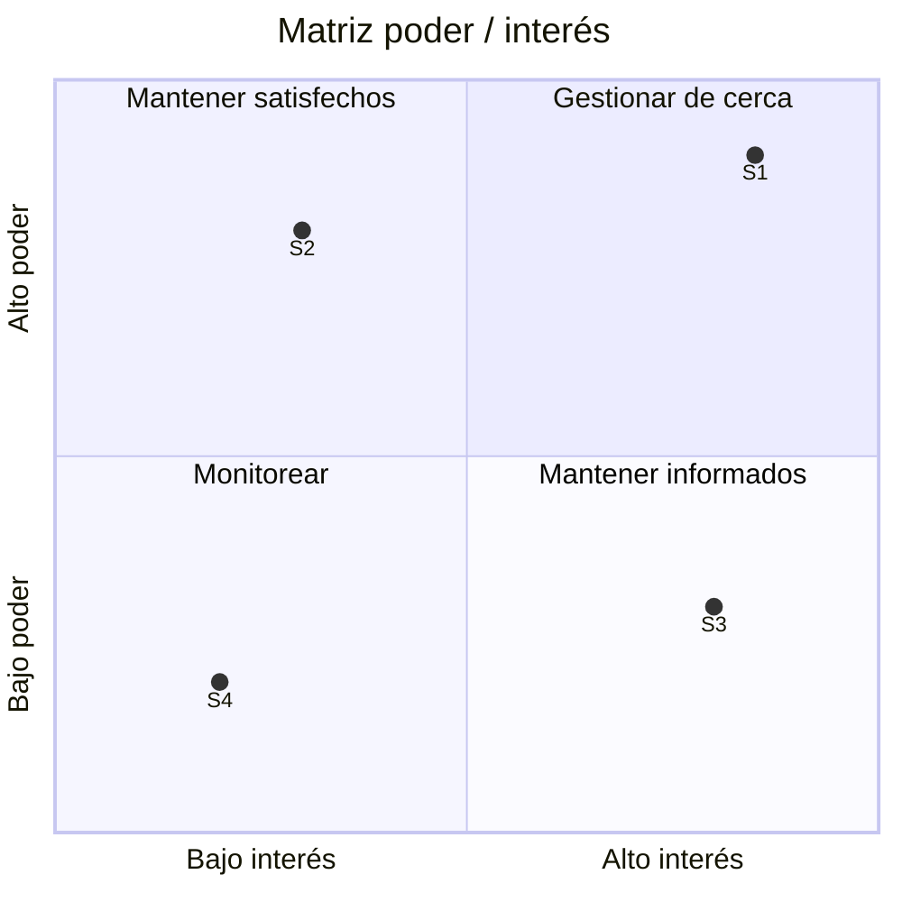

# 📇 Registro de Interesados (Parte A)

> Partir de los roles de la RACI ([`matriz-raci.md`](../03-raci/matriz-raci.md)) y ampliar al entorno externo. Considerar interesados **internos** (sponsor, equipo, usuarios, otras áreas) y **externos** (proveedores, organismos de control, clientes finales).

| ID | Interesado (nombre / rol) | Influencia (A/M/B) | Interés (A/M/B) | Información que necesita | Propósito (para qué la necesita) | Estrategia de comunicación |
|----|---------------------------|:------------------:|:---------------:|--------------------------|----------------------------------|----------------------------|
| S1 | [COMPLETAR] | [A/M/B] | [A/M/B] | [COMPLETAR] | [COMPLETAR] | [COMPLETAR] |
| S2 | [COMPLETAR] | [COMPLETAR] | [COMPLETAR] | [COMPLETAR] | [COMPLETAR] | [COMPLETAR] |
| S3 | [COMPLETAR] | [COMPLETAR] | [COMPLETAR] | [COMPLETAR] | [COMPLETAR] | [COMPLETAR] |
| S4 | [COMPLETAR] | [COMPLETAR] | [COMPLETAR] | [COMPLETAR] | [COMPLETAR] | [COMPLETAR] |
| S5 | [COMPLETAR] | [COMPLETAR] | [COMPLETAR] | [COMPLETAR] | [COMPLETAR] | [COMPLETAR] |

> **Estrategia** según el cuadrante: *Alta influencia + alto interés* → gestionar de cerca · *Alta influencia + bajo interés* → mantener satisfechos · *Baja influencia + alto interés* → mantener informados · *Baja + baja* → monitorear.

## Matriz poder / interés (opcional)

> Reemplazar los puntos del ejemplo por los interesados del registro (valores entre 0 y 1).

---

*Área de Posgrado · Gestión de Proyectos · Especializaciones FIUNER · 2026*
