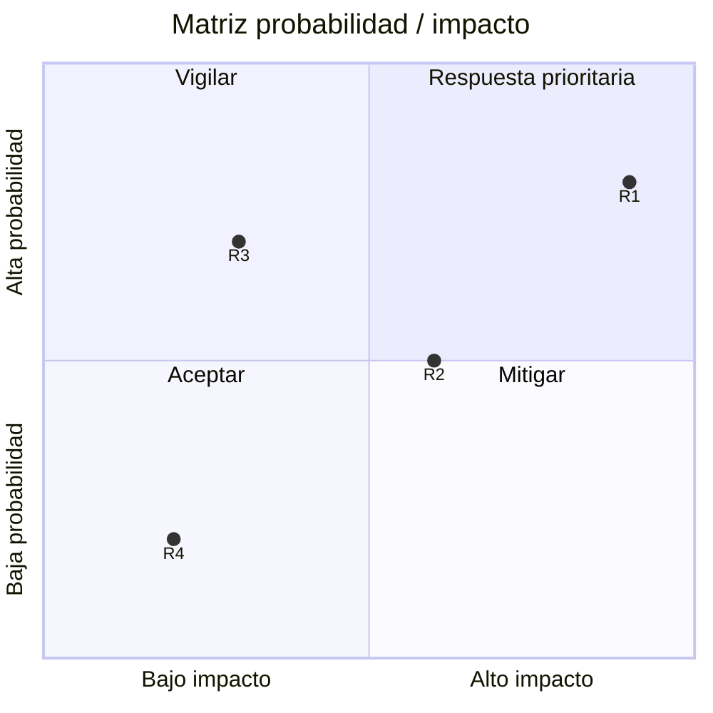

# ⚠️ Registro de Riesgos

## Fuentes de identificación

> [COMPLETAR: técnicas usadas para identificar los riesgos (tormenta de ideas, revisión de la EDT y de los supuestos, lecciones aprendidas, consulta a expertos, normativa aplicable) y quiénes participaron.]

## Registro

| ID | Sentencia del riesgo | Categoría | Paquete EDT afectado | Prob. (1-10) | Impacto (1-10) | Exposición (P×I) | Prioridad |
|----|---------------------|-----------|----------------------|:------------:|:--------------:|:----------------:|:---------:|
| R1 | **Debido a** [causa], **puede ocurrir** [riesgo], **lo que provocaría** [consecuencia]. | [Técnico / Regulatorio / Organizacional / Externo / Gestión] | [COMPLETAR] | [COMPLETAR] | [COMPLETAR] | [COMPLETAR] | [Alta/Media/Baja] |
| R2 | **Debido a** [causa], **puede ocurrir** [riesgo], **lo que provocaría** [consecuencia]. | [COMPLETAR] | [COMPLETAR] | [COMPLETAR] | [COMPLETAR] | [COMPLETAR] | [COMPLETAR] |
| R3 | **Debido a** [causa], **puede ocurrir** [riesgo], **lo que provocaría** [consecuencia]. | [COMPLETAR] | [COMPLETAR] | [COMPLETAR] | [COMPLETAR] | [COMPLETAR] | [COMPLETAR] |
| R4 | **Debido a** [causa], **puede ocurrir** [riesgo], **lo que provocaría** [consecuencia]. | [COMPLETAR] | [COMPLETAR] | [COMPLETAR] | [COMPLETAR] | [COMPLETAR] | [COMPLETAR] |
| R5 | **Debido a** [causa], **puede ocurrir** [riesgo], **lo que provocaría** [consecuencia]. | [COMPLETAR] | [COMPLETAR] | [COMPLETAR] | [COMPLETAR] | [COMPLETAR] | [COMPLETAR] |

> **Escala de prioridad:** Exposición ≥ 50 → Alta · 25-49 → Media · < 25 → Baja
> Se pueden incluir **oportunidades** (riesgos positivos) indicándolas con el prefijo `O` (O1, O2…).

## Criterios de probabilidad e impacto

| Valor | Probabilidad | Impacto en el proyecto |
|:-----:|-------------|------------------------|
| 1-3 | [COMPLETAR: p. ej. poco probable en la duración del proyecto] | [COMPLETAR: p. ej. demora < 1 semana, sin efecto en requisitos] |
| 4-6 | [COMPLETAR] | [COMPLETAR] |
| 7-10 | [COMPLETAR] | [COMPLETAR] |

## Matriz de exposición

> Reemplazar los puntos por los riesgos del registro (valores entre 0 y 1: valor / 10).

## Supuestos y restricciones

| Tipo | Descripción | Riesgo asociado si no se cumple |
|------|-------------|:-------------------------------:|
| Supuesto | [COMPLETAR] | [R?] |
| Restricción | [COMPLETAR] | [R?] |

---

*Área de Posgrado · Gestión de Proyectos · Especializaciones FIUNER · 2026*
