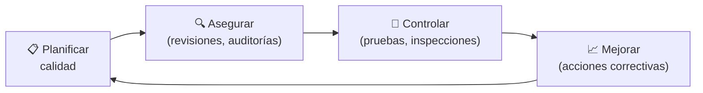

# ✅ Gestión de la Calidad

## Política y objetivos de calidad

> [COMPLETAR: qué significa calidad para este proyecto y cuáles son los objetivos medibles.]

| Objetivo de calidad | Métrica | Meta | Cómo se mide |
|---------------------|---------|:----:|--------------|
| [COMPLETAR] | [COMPLETAR] | [COMPLETAR] | [COMPLETAR] |
| [COMPLETAR] | [COMPLETAR] | [COMPLETAR] | [COMPLETAR] |

## Calidad por entregable

| Entregable | Criterio de aceptación | Actividad de verificación | Responsable | Cuándo |
|-----------|------------------------|---------------------------|-------------|:------:|
| [COMPLETAR] | [COMPLETAR] | [Revisión / Prueba / Inspección / Demostración] | [COMPLETAR] | [COMPLETAR] |
| [COMPLETAR] | [COMPLETAR] | [COMPLETAR] | [COMPLETAR] | [COMPLETAR] |

## Aseguramiento de la calidad

| Actividad de aseguramiento | Frecuencia | Responsable |
|---------------------------|:----------:|-------------|
| Revisión entre pares | [COMPLETAR] | [COMPLETAR] |
| Auditoría de proceso | [COMPLETAR] | [COMPLETAR] |

## Gestión de no conformidades

| Paso | Definición |
|------|------------|
| Registro | [COMPLETAR: dónde y con qué datos] |
| Clasificación (severidad) | [COMPLETAR] |
| Resolución y verificación | [COMPLETAR] |

## Adquisiciones y calidad de proveedores

> [COMPLETAR: qué se adquiere o subcontrata y cómo se asegura su calidad.]

---

*Área de Posgrado · Gestión de Proyectos · Especializaciones FIUNER · 2026*
