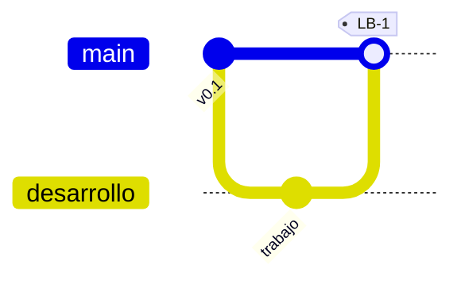

# 🧩 Gestión de la Configuración

> Define qué elementos del proyecto se controlan, cómo se versionan y cómo se aprueban sus cambios.

## Ítems de configuración

| ID | Ítem | Tipo | Responsable | Ubicación / repositorio | Convención de versión |
|----|------|------|-------------|------------------------|:---------------------:|
| CI-01 | [COMPLETAR] | [Documento / Código / Diseño / Datos / Herramienta] | [COMPLETAR] | [COMPLETAR] | [COMPLETAR] |
| CI-02 | [COMPLETAR] | [COMPLETAR] | [COMPLETAR] | [COMPLETAR] | [COMPLETAR] |
| CI-03 | [COMPLETAR] | [COMPLETAR] | [COMPLETAR] | [COMPLETAR] | [COMPLETAR] |

## Líneas base

| Línea base | Ítems incluidos | Se establece en | Aprobada por |
|-----------|-----------------|-----------------|--------------|
| LB-1 | [COMPLETAR] | [COMPLETAR: hito] | [COMPLETAR] |
| LB-2 | [COMPLETAR] | [COMPLETAR: hito] | [COMPLETAR] |

## Esquema de versionado y ramas

> [COMPLETAR: convención de versiones, nombres de ramas, quién puede integrar a la rama principal.]

## Control de acceso y respaldo

| Aspecto | Definición |
|---------|------------|
| Quién puede modificar ítems en línea base | [COMPLETAR] |
| Respaldo (frecuencia y lugar) | [COMPLETAR] |

## Auditoría de configuración

> [COMPLETAR: cómo y cuándo se verifica que lo entregado coincide con lo aprobado.]

> Los cambios sobre ítems en línea base siguen el circuito de [`integracion.md`](integracion.md).

---

*Área de Posgrado · Gestión de Proyectos · Especializaciones FIUNER · 2026*
