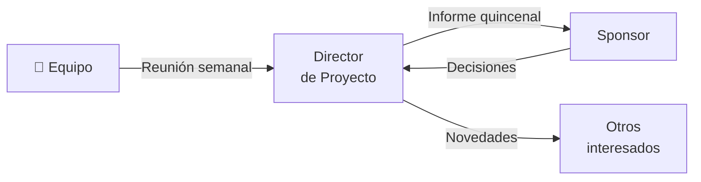

# 🤝 Gestión de Interesados y Comunicaciones

> Parte de [`03-interesados-raci/`](../03-interesados-raci/) y define cómo se involucra y se informa a cada interesado durante el proyecto.

## Plan de involucramiento

| Interesado | Actitud actual → deseada | Acción de involucramiento | Frecuencia | Responsable |
|-----------|--------------------------|---------------------------|:----------:|-------------|
| [COMPLETAR] | [COMPLETAR] → [COMPLETAR] | [COMPLETAR] | [COMPLETAR] | [COMPLETAR] |
| [COMPLETAR] | [COMPLETAR] → [COMPLETAR] | [COMPLETAR] | [COMPLETAR] | [COMPLETAR] |

## Plan de comunicaciones

| # | Comunicación | Audiencia | Contenido | Medio | Frecuencia | Responsable |
|---|-------------|-----------|-----------|-------|:----------:|-------------|
| 1 | Reunión de seguimiento | Equipo | Avance, bloqueos, próximos pasos | [COMPLETAR] | Semanal | [COMPLETAR] |
| 2 | Informe de estado | Sponsor | Avance, riesgos, cambios | [COMPLETAR] | Quincenal | [COMPLETAR] |
| 3 | [COMPLETAR] | [COMPLETAR] | [COMPLETAR] | [COMPLETAR] | [COMPLETAR] | [COMPLETAR] |

## Flujo de comunicación

## Gestión de conflictos y escalamiento

> [COMPLETAR: cómo se escalan problemas y a quién, con plazos.]

---

*Área de Posgrado · Gestión de Proyectos · Especializaciones FIUNER · 2026*
