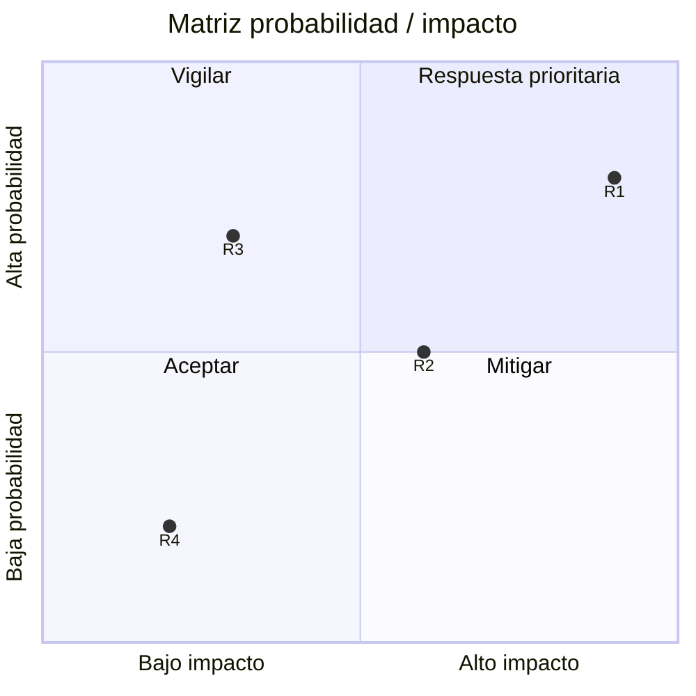

# ⚠️ Gestión de Riesgos

## Registro de riesgos

| ID | Sentencia del riesgo | Categoría | Prob. (1-10) | Impacto (1-10) | Exposición (P×I) | Prioridad |
|----|---------------------|-----------|:------------:|:--------------:|:----------------:|:---------:|
| R1 | **Si** [condición], **entonces** [consecuencia]. | [Técnico / Organizacional / Externo / Gestión] | [COMPLETAR] | [COMPLETAR] | [COMPLETAR] | [Alta/Media/Baja] |
| R2 | **Si** [condición], **entonces** [consecuencia]. | [COMPLETAR] | [COMPLETAR] | [COMPLETAR] | [COMPLETAR] | [COMPLETAR] |
| R3 | **Si** [condición], **entonces** [consecuencia]. | [COMPLETAR] | [COMPLETAR] | [COMPLETAR] | [COMPLETAR] | [COMPLETAR] |
| R4 | **Si** [condición], **entonces** [consecuencia]. | [COMPLETAR] | [COMPLETAR] | [COMPLETAR] | [COMPLETAR] | [COMPLETAR] |
| R5 | **Si** [condición], **entonces** [consecuencia]. | [COMPLETAR] | [COMPLETAR] | [COMPLETAR] | [COMPLETAR] | [COMPLETAR] |

> **Escala de prioridad:** Exposición ≥ 50 → Alta · 25-49 → Media · < 25 → Baja

## Matriz de exposición

> Reemplazar los puntos por los riesgos del registro (valores entre 0 y 1: valor / 10).

## Plan de respuesta

| ID | Estrategia | Acción | Disparador | Responsable | Fecha | Riesgo residual |
|----|-----------|--------|------------|-------------|:-----:|:---------------:|
| R1 | [Evitar / Mitigar / Transferir / Aceptar] | [COMPLETAR] | [COMPLETAR] | [COMPLETAR] | [COMPLETAR] | [COMPLETAR] |
| R2 | [COMPLETAR] | [COMPLETAR] | [COMPLETAR] | [COMPLETAR] | [COMPLETAR] | [COMPLETAR] |

## Reserva y seguimiento

| Concepto | Valor |
|----------|-------|
| Reserva de contingencia (tiempo) | [COMPLETAR] días |
| Reserva de contingencia (costo) | $[COMPLETAR] |
| Frecuencia de revisión del registro | [COMPLETAR] |

---

*Área de Posgrado · Gestión de Proyectos · Especializaciones FIUNER · 2026*
