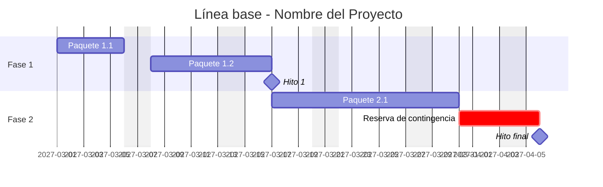

# ⏱️ Gestión del Tiempo

> Consolida el trabajo de [`02-edt-estimacion/`](../02-edt-estimacion/) y lo lleva a una **línea base de cronograma**.

## Cronograma consolidado

## Hitos

| Hito | Descripción | Fecha línea base | Criterio |
|------|-------------|:----------------:|----------|
| M1 | [COMPLETAR] | [COMPLETAR] | [COMPLETAR] |
| M2 | [COMPLETAR] | [COMPLETAR] | [COMPLETAR] |

## Ruta crítica y holguras

> [COMPLETAR: ruta crítica del proyecto y tareas con menor holgura. Referenciar `red-de-tareas.md`.]

## Optimización del cronograma

> [COMPLETAR: si fue necesario comprimir (paralelizar, reasignar recursos), qué se hizo y qué riesgo se agregó.]

## Control del cronograma

| Indicador | Cómo se calcula | Umbral | Acción |
|-----------|-----------------|:------:|--------|
| Desvío de hitos | Fecha real − fecha línea base | > [X] días | [COMPLETAR] |
| % de avance | Paquetes completos / total | [COMPLETAR] | [COMPLETAR] |

---

*Área de Posgrado · Gestión de Proyectos · Especializaciones FIUNER · 2026*
