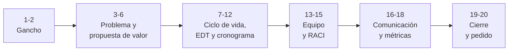

# 🎬 Guion del PechaKucha

> 20 diapositivas × 20 segundos. Una idea por diapositiva, poca palabra, mucha imagen o diagrama.

## Estructura narrativa

## Mensaje central

> **[COMPLETAR: en una sola frase, ¿por qué el comité debería aprobar este proyecto?]**

## Guion diapositiva por diapositiva

| Nº | Idea de la diapositiva (sugerida) | Mensaje y apoyo visual del equipo | Evidencia en el plan | Expone |
|:--:|-----------------------------------|-----------------------------------|----------------------|--------|
| 1 | Gancho: un dato, una escena o una pregunta | [COMPLETAR] | — | [COMPLETAR] |
| 2 | Gancho: por qué este tema importa ahora | [COMPLETAR] | — | [COMPLETAR] |
| 3 | El problema o la oportunidad | [COMPLETAR] | `proyecto-y-propuesta-de-valor.md` | [COMPLETAR] |
| 4 | A quién afecta y cómo | [COMPLETAR] | `proyecto-y-propuesta-de-valor.md` | [COMPLETAR] |
| 5 | El producto | [COMPLETAR] | `proyecto-y-propuesta-de-valor.md` | [COMPLETAR] |
| 6 | Propuesta de valor | [COMPLETAR] | `proyecto-y-propuesta-de-valor.md` | [COMPLETAR] |
| 7 | Ciclo de vida elegido y por qué | [COMPLETAR] | `ciclo-de-vida.md` | [COMPLETAR] |
| 8 | Fases y criterios de salida | [COMPLETAR] | `ciclo-de-vida.md` | [COMPLETAR] |
| 9 | Entregables y EDT | [COMPLETAR] | `entregables.md`, `edt.md` | [COMPLETAR] |
| 10 | Estimaciones (Delphi) | [COMPLETAR] | `estimacion.md` | [COMPLETAR] |
| 11 | Camino crítico | [COMPLETAR] | `red-de-tareas.md` | [COMPLETAR] |
| 12 | Cronograma e hitos | [COMPLETAR] | `cronograma.md` | [COMPLETAR] |
| 13 | El equipo y sus roles | [COMPLETAR] | `organizacion.md` | [COMPLETAR] |
| 14 | Matriz RACI | [COMPLETAR] | `matriz-raci.md` | [COMPLETAR] |
| 15 | Carga y dedicación | [COMPLETAR] | `matriz-raci.md` | [COMPLETAR] |
| 16 | Interesados | [COMPLETAR] | `registro-interesados.md` | [COMPLETAR] |
| 17 | Cómo nos comunicamos | [COMPLETAR] | `plan-comunicaciones.md` | [COMPLETAR] |
| 18 | OKR e indicadores | [COMPLETAR] | `okr-indicadores.md` | [COMPLETAR] |
| 19 | El pedido concreto al comité | [COMPLETAR] | — | [COMPLETAR] |
| 20 | Por qué ahora: cierre | [COMPLETAR] | — | [COMPLETAR] |

> La estructura es sugerida y puede adaptarse: lo importante es una idea por diapositiva y que cada tema de las cinco tareas tenga su lugar.

## Consejos

- Mostrar las decisiones y su justificación, no solo los artefactos.
- Ensayar con cronómetro: las diapositivas avanzan solas cada 20 segundos.
- Repartir la palabra entre todos los integrantes.
- Preparar respuestas a: ¿qué es lo que más puede salir mal?, ¿qué pasa si cambia el alcance?, ¿cómo se sabe que el proyecto va bien?

---

*Área de Posgrado · Gestión de Proyectos · Especializaciones FIUNER · 2026*
