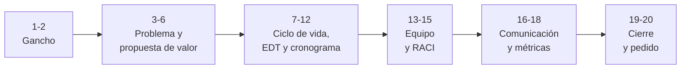

# 🎬 Guion del PechaKucha

> 20 diapositivas × 20 segundos. Una idea por diapositiva, poca palabra, mucha imagen o diagrama.

## Estructura narrativa

## Guion por bloque

| Diapositivas | Mensaje clave | Evidencia del plan | Quién presenta |
|:------------:|---------------|--------------------|----------------|
| 1–2 | [COMPLETAR: gancho que atrapa a la audiencia] | — | [COMPLETAR] |
| 3–6 | [COMPLETAR: problema y propuesta de valor] | `proyecto-y-propuesta-de-valor.md` | [COMPLETAR] |
| 7–12 | [COMPLETAR: ciclo de vida elegido, EDT, camino crítico y cronograma] | `ciclo-de-vida.md`, `edt.md`, `cronograma.md` | [COMPLETAR] |
| 13–15 | [COMPLETAR: estructura del equipo y RACI] | `organizacion.md`, `matriz-raci.md` | [COMPLETAR] |
| 16–18 | [COMPLETAR: comunicación con interesados, OKR e indicadores] | `registro-interesados.md`, `plan-comunicaciones.md`, `okr-indicadores.md` | [COMPLETAR] |
| 19–20 | [COMPLETAR: qué se solicita al sponsor y cierre] | — | [COMPLETAR] |

## Consejos

- Mostrar las decisiones y su justificación, no solo los artefactos.
- Ensayar con cronómetro: las diapositivas avanzan solas cada 20 segundos.
- Repartir la palabra entre todos los integrantes.
- Preparar respuestas a: ¿qué es lo que más puede salir mal?, ¿qué pasa si cambia el alcance?, ¿cómo se sabe que el proyecto va bien?

---

*Área de Posgrado · Gestión de Proyectos · Especializaciones FIUNER · 2026*
