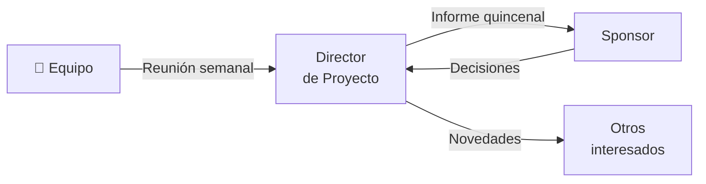

# 📣 Plan de Comunicaciones

> Parte de [`necesidades-informacion.md`](necesidades-informacion.md).

## Matriz de comunicaciones

| # | Comunicación | Audiencia | Contenido | Método | Medio | Frecuencia | Responsable |
|---|-------------|-----------|-----------|:------:|-------|:----------:|-------------|
| 1 | Reunión de seguimiento | Equipo | Avance, bloqueos, próximos pasos | Interactivo | [COMPLETAR] | Semanal | [COMPLETAR] |
| 2 | Informe de estado | Sponsor | Avance, riesgos, cambios | Push | [COMPLETAR] | Quincenal | [COMPLETAR] |
| 3 | [COMPLETAR] | [COMPLETAR] | [COMPLETAR] | [COMPLETAR] | [COMPLETAR] | [COMPLETAR] | [COMPLETAR] |
| 4 | [COMPLETAR] | [COMPLETAR] | [COMPLETAR] | [COMPLETAR] | [COMPLETAR] | [COMPLETAR] | [COMPLETAR] |

> **Método:** *Interactivo* (reuniones, llamadas), *Push* (se envía: correos, informes), *Pull* (el interesado lo consulta: repositorio, tablero, wiki).

## Flujo de comunicación

> Reemplazar los nodos y flechas por las comunicaciones de la matriz.

## Herramientas y repositorio de información

| Herramienta | Uso | Quién tiene acceso |
|-------------|-----|--------------------|
| [COMPLETAR] | [COMPLETAR] | [COMPLETAR] |

## Escalamiento

| Nivel | Quién resuelve | Plazo máximo | Si no se resuelve |
|:-----:|----------------|:------------:|-------------------|
| 1 | [COMPLETAR: p. ej. responsable del paquete] | [COMPLETAR] | Pasa al nivel 2 |
| 2 | [COMPLETAR: p. ej. Director de Proyecto] | [COMPLETAR] | Pasa al nivel 3 |
| 3 | [COMPLETAR: p. ej. Sponsor] | [COMPLETAR] | [COMPLETAR] |

---

*Área de Posgrado · Gestión de Proyectos · Especializaciones FIUNER · 2026*
