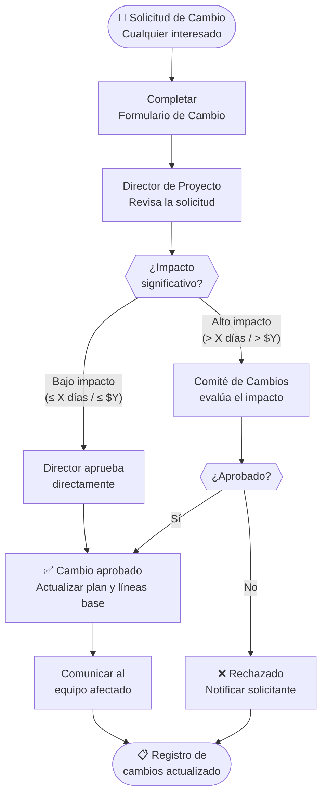

# 🔗 Gestión de la Integración

## Ciclo de vida y enfoque de gestión

> Resumen de [`ciclo-de-vida.md`](../01-ciclo-de-vida/ciclo-de-vida.md) y de cómo se articulan las áreas de este integrador: [COMPLETAR]

## Principios del PMBOK 7 aplicados

| # | Principio | Cómo se refleja en este proyecto |
|---|-----------|----------------------------------|
| 1 | Ser un administrador diligente, respetuoso y cuidadoso | [COMPLETAR] |
| 2 | Crear un entorno colaborativo | [COMPLETAR] |
| 3 | Involucrarse eficazmente con los interesados | [COMPLETAR] |
| 4 | Enfocarse en el valor | [COMPLETAR] |
| 5 | Reconocer, evaluar y responder a las interacciones del sistema | [COMPLETAR] |
| 6 | Demostrar comportamientos de liderazgo | [COMPLETAR] |
| 7 | Adaptar el enfoque según el contexto | [COMPLETAR] |
| 8 | Incorporar la calidad en procesos y entregables | [COMPLETAR] |
| 9 | Navegar en la complejidad | [COMPLETAR] |
| 10 | Optimizar las respuestas a los riesgos | [COMPLETAR] |
| 11 | Adoptar la adaptabilidad y la resiliencia | [COMPLETAR] |
| 12 | Facilitar el cambio para lograr el estado futuro previsto | [COMPLETAR] |

> No hace falta completar los doce con la misma extensión: priorizar los que más condicionan al proyecto y justificar.

## Ejecución, monitoreo y control

| Reunión / mecanismo | Objetivo | Frecuencia | Participantes | Salida |
|---------------------|----------|:----------:|---------------|--------|
| Seguimiento | [COMPLETAR] | Semanal | [COMPLETAR] | [COMPLETAR] |
| Revisión de hito | [COMPLETAR] | Por hito | [COMPLETAR] | [COMPLETAR] |

## Control integrado de cambios

### Roles

| Rol | Persona | Responsabilidad |
|-----|---------|----------------|
| Solicitante | Cualquier interesado | Completar el formulario de cambio |
| Evaluador inicial | [COMPLETAR — Director de Proyecto] | Analizar impacto y urgencia |
| Comité de Cambios | [COMPLETAR] | Aprobar cambios de alto impacto |
| Implementador | [COMPLETAR] | Ejecutar el cambio aprobado |

### Criterios de aprobación

| Criterio | Aprobación directa (Director) | Requiere Comité |
|----------|:-----------------------------:|:---------------:|
| Impacto en cronograma | ≤ [X] días | > [X] días |
| Impacto en presupuesto | ≤ $[Y] | > $[Y] |
| Cambio en alcance o línea base | No afecta entregables | Afecta entregables |
| Urgencia | Normal | Crítico |

### Registro de cambios

> Ver plantilla: [`formulario-cambio.md`](../../plantillas/formulario-cambio.md)

| # | Fecha | Descripción del cambio | Solicitante | Estado | Impacto |
|---|-------|------------------------|------------|:------:|---------|
| CC-001 | [COMPLETAR] | [COMPLETAR] | [COMPLETAR] | [Aprobado/Rechazado/En análisis] | [COMPLETAR] |

## Cambios respecto de entregas previas

| Artefacto | Cambio realizado | Motivo | Formulario |
|-----------|------------------|--------|:----------:|
| [COMPLETAR] | [COMPLETAR] | [COMPLETAR] | [CC-00X] |

## Cierre del proyecto o de fase

| Actividad de cierre | Responsable | Evidencia |
|--------------------|-------------|-----------|
| Verificar entregables aceptados | [COMPLETAR] | [COMPLETAR] |
| Cierre de adquisiciones | [COMPLETAR] | [COMPLETAR] |
| Archivo de documentación | [COMPLETAR] | [COMPLETAR] |
| Liberación de recursos | [COMPLETAR] | [COMPLETAR] |

### Lecciones aprendidas

| Qué funcionó | Qué no funcionó | Recomendación |
|--------------|-----------------|---------------|
| [COMPLETAR] | [COMPLETAR] | [COMPLETAR] |

---

*Área de Posgrado · Gestión de Proyectos · Especializaciones FIUNER · 2026*
