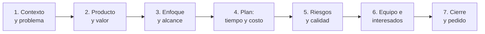

# 🎬 Guion de la Presentación

> Estructura sugerida. Ajustar la cantidad de diapositivas al tiempo disponible: [A CONFIRMAR].

## Estructura narrativa

## Guion por bloque

| Bloque | Mensaje clave | Evidencia del plan | Responsable | Tiempo |
|:------:|---------------|--------------------|-------------|:------:|
| 1 | [COMPLETAR: qué problema se resuelve] | `proyecto-base.md` | [COMPLETAR] | [COMPLETAR] |
| 2 | [COMPLETAR: qué producto y qué valor] | `proyecto-base.md`, `alcance.md` | [COMPLETAR] | [COMPLETAR] |
| 3 | [COMPLETAR: ciclo de vida elegido y alcance] | `ciclo-de-vida.md`, `alcance.md` | [COMPLETAR] | [COMPLETAR] |
| 4 | [COMPLETAR: cronograma, hitos y costo] | `tiempos.md`, `estimacion.md` | [COMPLETAR] | [COMPLETAR] |
| 5 | [COMPLETAR: principales riesgos y cómo se asegura la calidad] | `registro-riesgos.md`, `riesgos.md`, `calidad.md` | [COMPLETAR] | [COMPLETAR] |
| 6 | [COMPLETAR: equipo, interesados y comunicación] | `matriz-raci.md`, `interesados.md`, `plan-comunicaciones.md` | [COMPLETAR] | [COMPLETAR] |
| 7 | [COMPLETAR: qué se solicita al sponsor] | `plan-proyecto.md` | [COMPLETAR] | [COMPLETAR] |

## Consejos

- Una idea por diapositiva y poco texto.
- Mostrar las decisiones y su justificación, no solo los artefactos.
- Preparar respuestas a: ¿qué es lo que más puede salir mal?, ¿qué pasa si cambia el alcance?, ¿cómo se sabe que el proyecto va bien?
- Ensayar con cronómetro.

---

*Área de Posgrado · Gestión de Proyectos · Especializaciones FIUNER · 2026*
